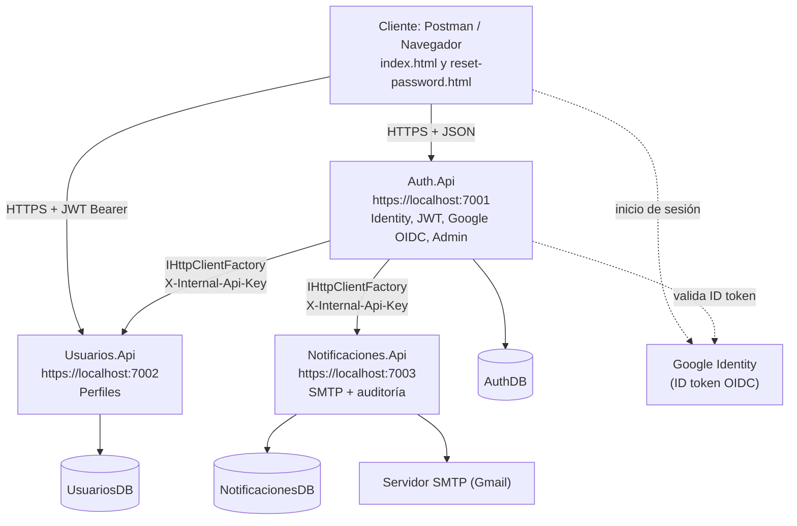

# Sistema distribuido de autenticación y seguridad (AA01)

**Institución:** Instituto Superior Tecnológico Cordillera
**Carrera:** Desarrollo de Software
**Asignatura:** Aplicaciones Distribuidas
**Actividad:** AA01 - Actividad autónoma (Primer bimestre)
**Estudiante:** Pablo Andrés Cueva Pallo
**Repositorio:** `DIST-4BM-B1-AA01-SeguridadDistribuida-CuevaPablo`

---

## 1. Descripción

Módulo distribuido de identidad, autenticación, autorización por roles y notificaciones para el sistema de gestión comercial del caso de estudio. Está formado por **tres APIs independientes** en ASP.NET Core Web API (.NET 10), cada una con su propia base de datos en SQL Server y su propio `DbContext`:

| Microservicio | Puerto HTTPS | Base de datos | Responsabilidad |
|---|---|---|---|
| `Auth.Api` | 7001 | `AuthDB` | Registro, login local, Google/OpenID Connect, hash de contraseñas, roles, JWT, recuperación de contraseña y administración de cuentas |
| `Usuarios.Api` | 7002 | `UsuariosDB` | Perfiles de usuario; cada usuario solo accede a su propio perfil |
| `Notificaciones.Api` | 7003 | `NotificacionesDB` | Envío real de correos por SMTP y registro del resultado, sin guardar tokens ni contraseñas |

Las APIs se comunican por HTTP/JSON con `IHttpClientFactory` (con `BaseAddress` y `Timeout` explícitos en `Program.cs`). Las bases de datos **no tienen llaves foráneas entre sí**: se relacionan solo por el identificador compartido `UsuarioId`.

## 2. Arquitectura



Reglas de datos:

- `Auth.Api` es dueña de credenciales, roles y estado de cuenta (habilitada o deshabilitada).
- `Usuarios.Api` es dueña de los datos del perfil.
- `Notificaciones.Api` es dueña del registro de envíos.
- Ninguna API consulta las tablas de otra: solo se llaman por HTTP.

## 3. Estructura del repositorio

```text
DIST-[PARALELO]-B1-AA01-SeguridadDistribuida-CuevaPablo/
├── SeguridadDistribuida.slnx
├── Auth.Api/
│   ├── Controllers/        AuthController.cs, AdminController.cs
│   ├── Data/               AuthDBContext.cs, DbSeeder.cs
│   ├── DTOs/               AuthDTOs.cs
│   ├── Models/             ApplicationUser.cs
│   ├── Services/           JwtService.cs
│   ├── wwwroot/            index.html (Google), reset-password.html
│   └── Program.cs
├── Usuarios.Api/
│   ├── Controllers/        UsuariosController.cs
│   ├── Data/               UsuariosDBContext.cs
│   ├── DTOs/               PerfilDTOs.cs
│   ├── Models/             Perfil.cs
│   └── Program.cs
├── Notificaciones.Api/
│   ├── Controllers/        NotificacionesController.cs
│   ├── Data/               NotificacionesDBContext.cs
│   ├── DTOs/               CorreoDTOs.cs
│   ├── Models/             EnvioCorreo.cs
│   └── Program.cs
├── database/
│   ├── 01_AuthDB.sql
│   ├── 02_UsuariosDB.sql
│   ├── 03_NotificacionesDB.sql
│   └── 04_DatosFicticios.sql
├── postman/
│   ├── AA01_SeguridadDistribuida.postman_collection.json
│   └── AA01_Entorno_SinSecretos.postman_environment.json
└── README.md
```

## 4. Cómo ejecutar el proyecto

### 4.1 Requisitos

- .NET 10 SDK
- SQL Server y SQL Server Management Studio (SSMS)
- Visual Studio
- Postman
- Una cuenta de Gmail con verificación en 2 pasos (para la contraseña de aplicación SMTP)
- Un proyecto en Google Cloud Console (para Google/OpenID Connect)

### 4.2 Crear las bases de datos

Ejecuta en SSMS, en este orden, los scripts de la carpeta `database/`:

1. `01_AuthDB.sql`: crea `AuthDB`, las tablas de ASP.NET Core Identity (con `NombreCompleto`, `CuentaHabilitada` y `FechaRegistro` en `AspNetUsers`) y los roles `Cliente` y `Administrador`.
2. `02_UsuariosDB.sql`: crea `UsuariosDB` y la tabla `Perfiles` con índice único sobre `UsuarioId`.
3. `03_NotificacionesDB.sql`: crea `NotificacionesDB` y la tabla `EnviosCorreo`.
4. `04_DatosFicticios.sql`: inserta perfiles y envíos de demostración (datos ficticios).

Si tu instancia de SQL Server no es `localhost`, cambia `DefaultConnection` en el `appsettings.json` de cada proyecto (por ejemplo `localhost\\SQLEXPRESS`).

### 4.3 Configurar los secretos

Ningún `appsettings.json` del repositorio contiene claves reales: todos tienen el texto `CONFIGURAR_EN_USER_SECRETS`. Los valores reales se guardan con **User Secrets** (clic derecho en el proyecto > *Administrar secretos de usuario*, o con `dotnet user-secrets set`). El `Jwt:Key` y el `InternalSecurity:ApiKey` deben ser **idénticos** en los proyectos donde aparecen.

| Proyecto | Claves en User Secrets |
|---|---|
| `Auth.Api` | `Jwt:Key` (mínimo 32 caracteres), `InternalSecurity:ApiKey`, `Google:ClientId`, `AdminSeed:Password` |
| `Usuarios.Api` | `Jwt:Key`, `InternalSecurity:ApiKey` |
| `Notificaciones.Api` | `InternalSecurity:ApiKey`, `Smtp:User`, `Smtp:Password` (contraseña de aplicación de Gmail) |

Ejemplo (con valores de relleno, no reales):

```bash
dotnet user-secrets set "Jwt:Key" "<clave-de-al-menos-32-caracteres>" --project Auth.Api
dotnet user-secrets set "InternalSecurity:ApiKey" "<clave-interna-compartida>" --project Auth.Api
```

Al iniciar `Auth.Api`, `DbSeeder` crea los roles si faltan y el administrador inicial con el correo de `AdminSeed:Email` (`appsettings.json`) y la contraseña de `AdminSeed:Password` (User Secrets).

### 4.4 Configurar Google Cloud (OpenID Connect)

1. En Google Cloud Console crea un proyecto de prueba.
2. En *Google Auth Platform*, configura la pantalla de consentimiento como **Externo** y agrega tu correo en **Usuarios de prueba**.
3. En *Acceso a los datos*, agrega los permisos `openid`, `email` y `profile`.
4. En *Clientes*, crea un **ID de cliente de OAuth** de tipo *Aplicación web* con el origen autorizado de JavaScript `https://localhost:7001`.
5. Guarda el ID de cliente en `Google:ClientId` (User Secrets de `Auth.Api`) y en el atributo `data-client_id` de `Auth.Api/wwwroot/index.html`.

> En el repositorio, `index.html` queda con el marcador `TU_GOOGLE_CLIENT_ID.apps.googleusercontent.com`. El ID real solo se coloca localmente para la prueba.

### 4.5 Levantar los servicios

En Visual Studio: clic derecho en la solución > *Configurar proyectos de inicio* > **Varios proyectos de inicio** y pon `Auth.Api`, `Usuarios.Api` y `Notificaciones.Api` en *Iniciar*. Verifica en `Properties/launchSettings.json` (perfil `https`):

| Proyecto | `applicationUrl` |
|---|---|
| `Auth.Api` | `https://localhost:7001;http://localhost:5001` |
| `Usuarios.Api` | `https://localhost:7002;http://localhost:5002` |
| `Notificaciones.Api` | `https://localhost:7003;http://localhost:5003` |

Cada API expone Swagger en modo Desarrollo.

### 4.6 Probar con Postman

1. Importa los dos archivos de la carpeta `postman/` y selecciona el entorno **AA01 - Entorno Local (Sin Secretos)**.
2. En Postman, desactiva *Enable SSL certificate verification* (certificados locales de desarrollo).
3. Completa solo en tu equipo las variables de prueba (`correoCliente`, `passwordCliente`, `correoAdmin`, `passwordAdmin`). Las variables `usuarioId`, `jwtCliente` y `jwtAdmin` las llenan solos los scripts de los casos de login y registro.
4. Antes de exportar o subir los archivos, deja vacías todas las variables sensibles.

## 5. Medidas de seguridad implementadas

- **Contraseñas:** `PasswordHasher` de ASP.NET Core Identity (PBKDF2). Política: mínimo 8 caracteres con mayúscula, minúscula, dígito y símbolo.
- **Bloqueo por intentos fallidos:** 3 intentos y bloqueo de 15 minutos (HTTP 423).
- **JWT:** firmado con HMAC-SHA256, vigencia de 60 minutos, y validación de firma, emisor, audiencia y expiración en `Auth.Api` y `Usuarios.Api`.
- **Roles y propiedad del recurso:** `[Authorize]`, roles `Cliente` y `Administrador`, y comprobación en el servidor de que el `UsuarioId` del token coincide con el del recurso.
- **Google OpenID Connect:** validación del ID token en el servidor (firma, audiencia y vigencia) con `GoogleJsonWebSignature`, exigencia de `email_verified` y vinculación por el identificador estable `sub` (tabla `AspNetUserLogins`). Rol `Cliente` por defecto y sin vinculación automática de cuentas locales preexistentes.
- **Recuperación de contraseña:** respuesta genérica que no revela si el correo existe, token de un solo uso con vigencia de 15 minutos (se invalida al cambiar el `SecurityStamp`) y token que no se guarda en base de datos ni se muestra en la respuesta.
- **Llamadas internas:** `Notificaciones.Api` y el endpoint interno de `Usuarios.Api` exigen la cabecera `X-Internal-Api-Key`; sin ella responden 401.
- **Administración:** no se puede degradar ni deshabilitar al último administrador activo.
- **Secretos:** fuera del repositorio (User Secrets), sin tokens ni contraseñas en logs o bitácoras.

## 6. Procesos de negocio distribuidos

### Flujo 1. Registro de usuario

| Campo | Detalle |
|---|---|
| API iniciadora | Cliente (Postman) hacia `Auth.Api` |
| API receptora | `Usuarios.Api` y `Notificaciones.Api` (llamadas desde `Auth.Api`) |
| Endpoints | `POST https://localhost:7001/api/auth/registro` (público), `POST https://localhost:7002/api/usuarios/interno` y `POST https://localhost:7003/api/notificaciones/enviar` (internos, con `X-Internal-Api-Key`) |

DTO de entrada:

```json
{
  "nombreCompleto": "Nombre Apellido",
  "correo": "usuario@dominio.com",
  "password": "<contraseña-segura>",
  "confirmarPassword": "<contraseña-segura>"
}
```

Respuesta esperada `201 Created`:

```json
{
  "mensaje": "Usuario registrado correctamente.",
  "usuarioId": "<guid>",
  "correo": "usuario@dominio.com",
  "rol": "Cliente"
}
```

Manejo de errores:

- Correo repetido: `409 Conflict`. Datos inválidos o contraseña débil: `400 Bad Request`.
- Si `Usuarios.Api` responde con error o está caída (`HttpRequestException`): `Auth.Api` ejecuta una **compensación** y elimina la identidad de `AuthDB`, y devuelve `503 Service Unavailable`.
- Si se supera el `Timeout` del `HttpClient` (`TaskCanceledException`): compensación y `408 Request Timeout`.
- Si falla `Notificaciones.Api`, el registro **no** se revierte; la excepción se captura sin exponer detalles.

### Flujo 2. Inicio de sesión local y JWT

| Campo | Detalle |
|---|---|
| API iniciadora | Cliente (Postman) |
| API receptora | `Auth.Api`; el JWT se usa después en `Usuarios.Api` |
| Endpoint | `POST https://localhost:7001/api/auth/login` |

DTO de entrada: `{ "correo": "...", "password": "..." }`

Respuesta esperada `200 OK`:

```json
{
  "token": "<jwt>",
  "expiracion": "2026-11-26T17:00:00Z",
  "usuarioId": "<guid>",
  "correo": "usuario@dominio.com",
  "roles": ["Cliente"]
}
```

Errores: `401` con mensaje genérico para credenciales inválidas, `403` si la cuenta está deshabilitada y `423` si está bloqueada por intentos fallidos.

### Flujo 3. Acceso con Google (OpenID Connect)

| Campo | Detalle |
|---|---|
| API iniciadora | Navegador en `https://localhost:7001/index.html` |
| API receptora | `Auth.Api`; en el primer ingreso llama a `Usuarios.Api` para crear el perfil |
| Endpoint | `POST https://localhost:7001/api/auth/google` |

DTO de entrada: `{ "idToken": "<id-token-de-google>" }`

Respuesta esperada `200 OK`: `token`, `expiracion`, `usuarioId`, `correo`, `roles` (`["Cliente"]`) y `proveedor` (`"Google"`).

Errores:

- ID token inválido, alterado o vencido, o correo no verificado: `401 Unauthorized`.
- Ya existe una cuenta local con ese correo: `409 Conflict` (no se vincula automáticamente).
- Falla la creación del perfil en `Usuarios.Api`: compensación y `503`.
- Cuenta deshabilitada: `403`.

### Flujo 4. Recuperación y restablecimiento de contraseña

| Campo | Detalle |
|---|---|
| API iniciadora | Cliente (Postman o navegador) |
| API receptora | `Auth.Api`; el correo lo envía `Notificaciones.Api` |
| Endpoints | `POST /api/auth/recuperar-password` y `POST /api/auth/restablecer-password` en `https://localhost:7001`; interno: `POST https://localhost:7003/api/notificaciones/enviar` |

DTO de entrada:

```json
{ "correo": "usuario@dominio.com" }
```

```json
{
  "correo": "usuario@dominio.com",
  "token": "<token-del-enlace>",
  "nuevaPassword": "<nueva-contraseña-segura>"
}
```

Respuestas:

- Solicitud: siempre `200 OK` con un mensaje genérico, exista o no el correo.
- Restablecimiento válido: `200 OK`.
- Token vencido, alterado o reutilizado: `400 Bad Request`.

Si `Notificaciones.Api` falla o supera el `Timeout`, `Auth.Api` captura la excepción y devuelve el mismo `200` genérico, sin mostrar el token ni el enlace. El enlace del correo abre `https://localhost:7001/reset-password.html?email=...&token=...` y solo funciona en el equipo donde corre `Auth.Api`.

### Flujo 5. Gestión del perfil

| Campo | Detalle |
|---|---|
| API iniciadora | Cliente (Postman) con JWT |
| API receptora | `Usuarios.Api` |
| Endpoints | `GET` y `PUT https://localhost:7002/api/usuarios/mi-perfil`, `GET https://localhost:7002/api/usuarios/{usuarioId}` |

DTO de entrada del `PUT`:

```json
{
  "nombreCompleto": "Nombre Apellido",
  "telefono": "0990000000",
  "ciudad": "Quito",
  "direccion": "Dirección de ejemplo"
}
```

Respuesta esperada `200 OK` con el perfil. Errores: `401` sin token o con JWT inválido o vencido, `403` si un Cliente consulta el perfil de otro usuario y `404` si el perfil no existe.

### Flujo 6. Administración de usuarios, roles y estado

| Campo | Detalle |
|---|---|
| API iniciadora | Administrador (Postman) con JWT de rol `Administrador` |
| API receptora | `Auth.Api` (`GET https://localhost:7002/api/usuarios` lista los perfiles, solo para Administrador) |
| Endpoints | `GET /api/admin/usuarios`, `PUT /api/admin/usuarios/{id}/rol` y `PUT /api/admin/usuarios/{id}/estado` en `https://localhost:7001` |

DTO de entrada:

```json
{ "nuevoRol": "Cliente" }
```

```json
{ "habilitada": false }
```

El `{id}` es el `Id` (GUID) de la tabla `AspNetUsers` de `AuthDB`.

Respuesta esperada `200 OK` con el cambio persistido. Errores: `401` o `403` si el JWT no es de Administrador, `404` si el usuario no existe y `400` si el rol no es válido o si se intenta degradar o deshabilitar al último administrador activo.

## 7. Casos de prueba (Postman)

| N.º | Caso | Petición | Resultado esperado |
|---|---|---|---|
| 1 | Registrar Cliente válido | `POST /api/auth/registro` | `201`; identidad en `AuthDB`, perfil en `UsuariosDB`, envío en `NotificacionesDB` |
| 2 | Registro duplicado o inválido | `POST /api/auth/registro` | `409` o `400` |
| 3 | Login correcto y erróneo | `POST /api/auth/login` | `200` con JWT; `401` y luego `423` tras 3 fallos |
| 4 | Perfil sin token o con JWT vencido | `GET :7002/api/usuarios/mi-perfil` | `401` |
| 5 | Cliente consulta perfil ajeno o ruta Admin | `GET :7002/api/usuarios/{otroId}`, `GET /api/admin/usuarios` | `403` |
| 6 | Admin cambia rol o estado | `PUT /api/admin/usuarios/{id}/rol` y `/estado` | `200` con cambio persistido |
| 7 | Login real con Google | Navegador en `/index.html` | JWT local emitido, rol `Cliente` |
| 8 | Token de Google inválido | `POST /api/auth/google` | `401` |
| 9 | Recuperación por correo real | `POST /api/auth/recuperar-password` | `200` genérico y correo recibido |
| 10 | Restablecer con token válido | `POST /api/auth/restablecer-password` | `200`; nuevo login exitoso |
| 11 | Token vencido o reutilizado | `POST /api/auth/restablecer-password` | `400` |
| 12 | Detener `Usuarios.Api` y registrar | `POST /api/auth/registro` | `503`; la cuenta no queda creada |
| 13 | Detener `Notificaciones.Api` y recuperar | `POST /api/auth/recuperar-password` | `200` genérico, sin token ni enlace |
| 14 | Latencia mayor al Timeout | `POST /api/auth/registro` | `408` por `TaskCanceledException` (no 504: no hay gateway) |
| 15 | Notificaciones sin autorización | `POST :7003/api/notificaciones/enviar` sin cabecera | `401` |
| 16 | Cambiar contraseña con la actual incorrecta | `POST /api/auth/cambiar-password` | `400`; el hash no cambia |

## 8. Notas de diseño

- Las tablas `AspNetUserTokens`, `AspNetUserClaims` y `AspNetRoleClaims` de `AuthDB` quedan vacías por diseño: el JWT y el token de recuperación no se guardan en base de datos, y los claims se arman al emitir el JWT.
- El `{id}` de las rutas de administración es el `Id` de `AspNetUsers`, que corresponde a `UsuarioId` en `UsuariosDB`; no es el `PerfilId`.
- No se implementó la autenticación de dos factores (opcional según la guía).

## 9. Limitaciones conocidas

- La compensación del registro elimina la identidad de `AuthDB`. Si `Usuarios.Api` llega a crear el perfil después de que `Auth.Api` canceló por timeout, puede quedar un perfil sin identidad en `UsuariosDB`.
- La comunicación entre APIs es síncrona por HTTP, sin reintentos automáticos.
- Sin gateway, Docker ni despliegue público, como pide la guía para este bimestre.
